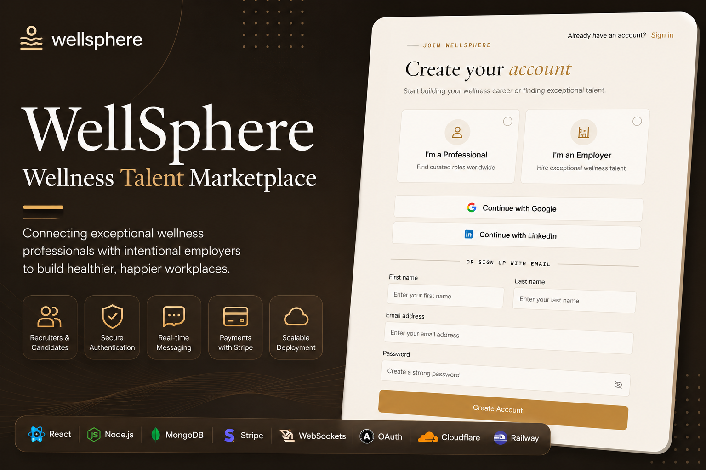
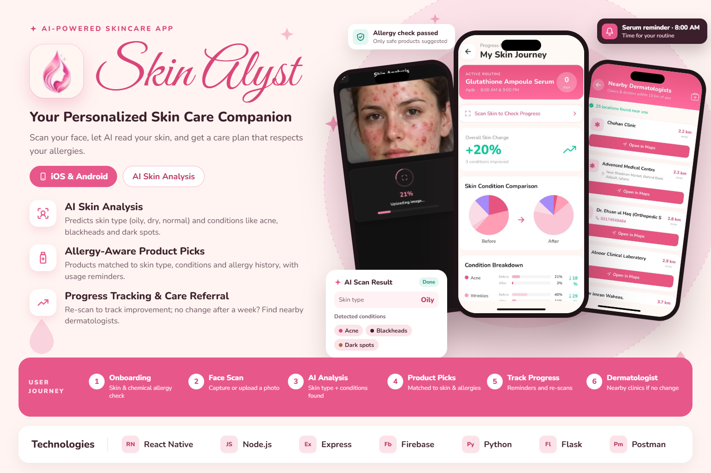
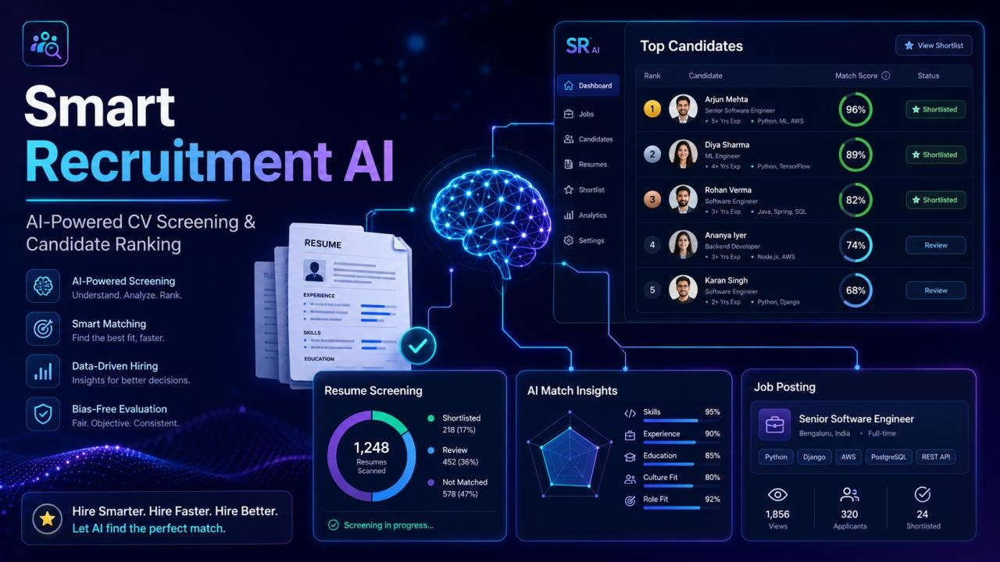
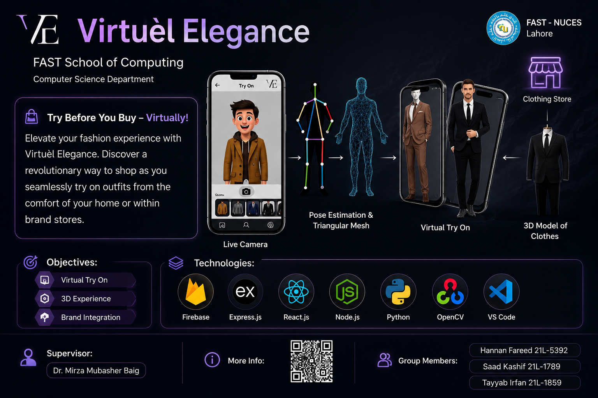
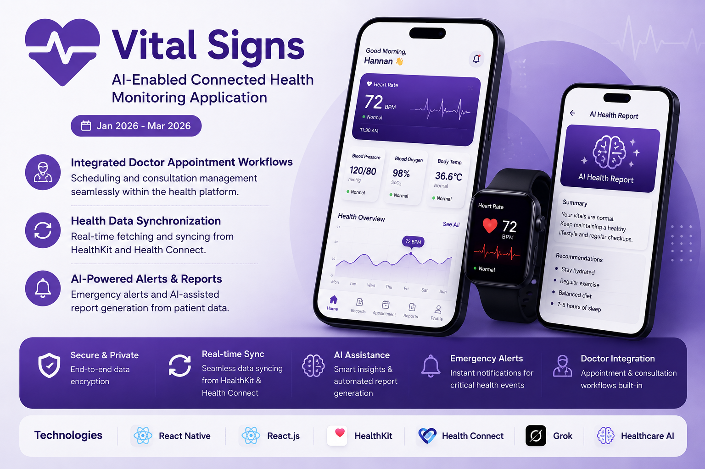
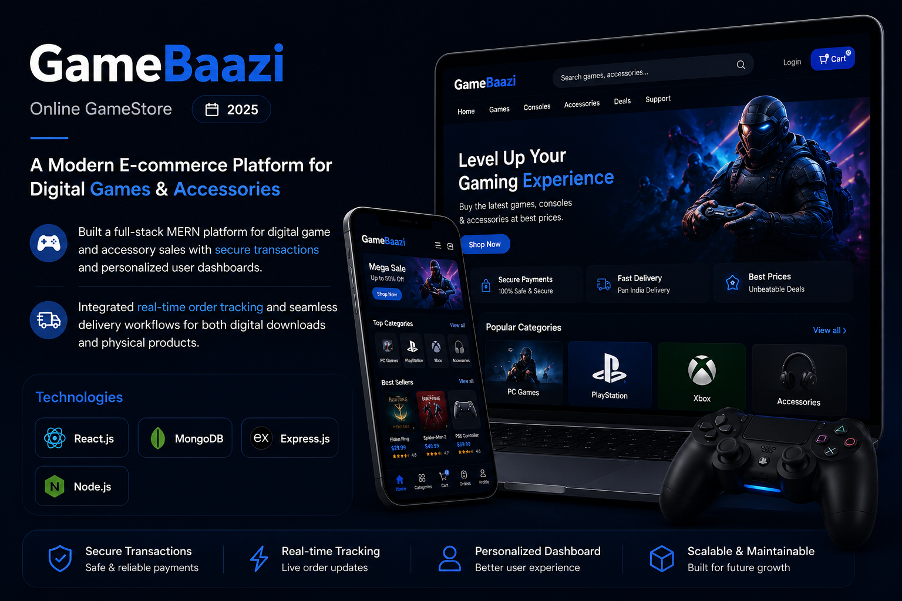
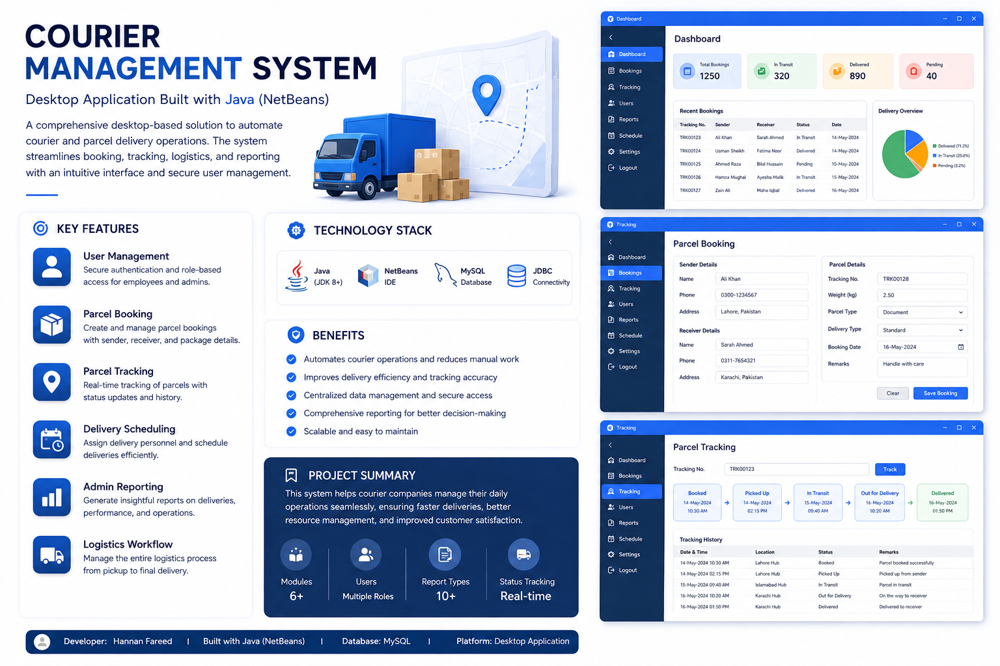

# Hi there! I'm Hannan Fareed 👋

  

  
  
  

---

## 👨‍💻 About Me

“To be, or not to be, that is the question.” — William Shakespeare, Hamlet, Act III, Scene I

I'm a Computer Science graduate and Software Engineer passionate about building scalable applications, enterprise solutions, mobile experiences, and AI-powered products.

My experience spans full-stack development, fintech applications, distributed systems, mobile development, and machine learning. I enjoy taking ideas from concept to implementation, solving complex engineering problems, and continuously exploring emerging technologies.

- 💼 Software Engineer working on enterprise fintech applications.
- 🏦 Experience with Java, Oracle platforms, and enterprise banking solutions.
- 🌐 Full-stack development using React, Angular, Node.js, and .NET Core.
- 📱 Mobile application development using React Native.
- 🤖 Building AI-powered products using NLP, computer vision, and machine learning.
- 🔍 Interested in system design, scalable architectures, and AI integrations.
- 🤝 Open to collaboration, challenging projects, and professional opportunities.

---

## ⭐ LATEST PROJECTS

<table>
<tr>
<td width="50%" valign="top">

<h3 align="center">🚀 WellSphere</h3>

**Talent & Recruitment Platform**

Recruiter-applicant platform connecting businesses and professionals with a centralized admin panel and scalable backend.

**Tech Stack**

</td>
<td width="50%" valign="top">

<h3 align="center">🧴 Skin Recommendation System</h3>

**AI-Powered Skincare Application**

Mobile application using custom CNN models to identify skin types and conditions and recommend suitable skincare products.

**Tech Stack**

</td>
</tr>

<tr>
<td width="50%" valign="top">

<h3 align="center">🤖 TalentRank AI</h3>

**Smart Recruitment System**

AI-powered recruitment platform featuring automated CV screening and candidate ranking using NLP, TF-IDF, SVM and Sentence-BERT.

**Tech Stack**

</td>
<td width="50%" valign="top">

<h3 align="center">🛒 TechHaveli</h3>

**E-commerce Application**

Full-stack MERN platform for online electronics and gadget sales, featuring authentication, product catalog, shopping cart and payment integration.

**Tech Stack**

</td>
</tr>
</table>

---

## 🔥 MORE PROJECTS

<table>
<tr>
<td width="33%" valign="top">

<h3 align="center">💃 Virtuel Elegance</h3>

Final Year Project featuring virtual clothing try-on using pose estimation and 3D clothing visualization.

</td>
<td width="33%" valign="top">

<h3 align="center">❤️ Vital Signs</h3>

AI-enabled connected health monitoring application with HealthKit and Health Connect integration, doctor appointments and AI-assisted reports.

</td>
<td width="33%" valign="top">

<h3 align="center">🩺 Healthcare Chatbot</h3>

NLP-based healthcare chatbot using Retrieval-Augmented Generation for context-aware medical responses.

</td>
</tr>

<tr>
<td width="33%" valign="top">

<h3 align="center">🎮 GameBaazi</h3>

Full-stack MERN platform for digital game and accessory sales with real-time order tracking.

</td>
<td width="33%" valign="top">

<h3 align="center">🏏 Cricket Bazaar</h3>

Predictive machine learning models estimating IPL auction prices using historical player data.

</td>
<td width="33%" valign="top">

<h3 align="center">⚡ Billee Sense</h3>

Predictive energy management system using Linear Regression and Neural Networks.

</td>
</tr>

<tr>
<td width="33%" valign="top">

<h3 align="center">📱 Edit Pixel</h3>

Android image editor with real-time filters, cropping and image enhancement tools.

</td>
<td width="33%" valign="top">

<h3 align="center">🚚 Speedify</h3>

Desktop courier management system automating parcel booking, tracking and admin reporting.

</td>
<td width="33%" valign="top">

<h3 align="center">🖼️ JPEG Compression</h3>

Grayscale JPEG compression implementation using DCT, quantization and zig-zag scanning.

</td>
</tr>
</table>

---

> 👉 Explore my pinned repositories for more projects, source code and demonstrations!

## 🛠️ Technical Skills

### Programming Languages

### Frameworks & Libraries

### Databases & Services

### AI, Machine Learning & Computer Vision

### Tools & Platforms

---

## 📊 GitHub Statistics

  

  
  

  
  

### 🔥 Contribution Streak

  

---

## 🏆 GitHub Achievements

  
  
  
  

  

---

## 🐍 Contribution Snake

  

---

## 🤝 Connect With Me

  
  
  
  
  

---

  <i>"Simplicity is the soul of efficiency."</i>

  

